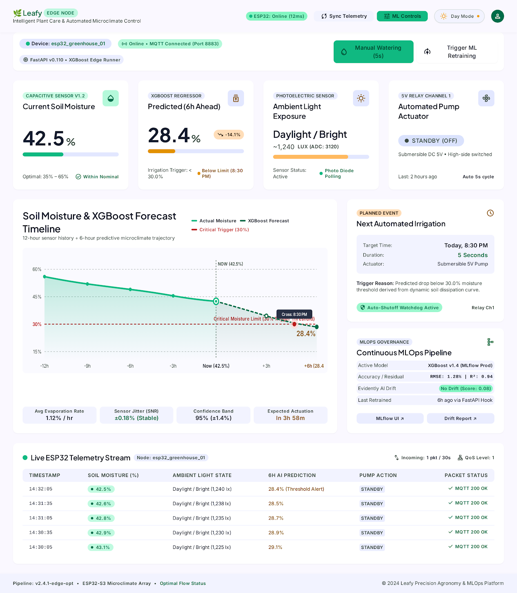
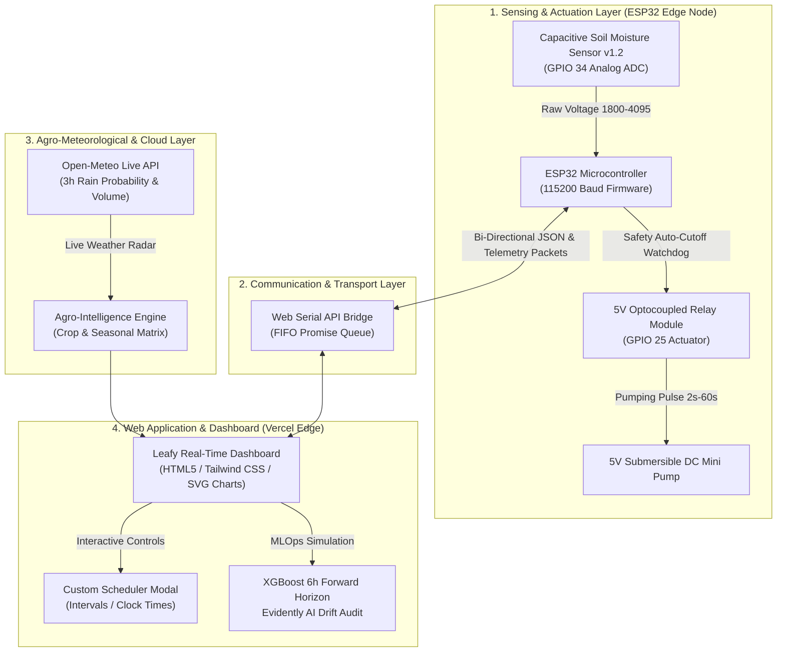

# 🌿 Leafy — Smart Plant Dashboard & Automated Microclimate Control

[](https://github.com/Aditi-Dayma/IOT_CP_Leafy)
[](https://github.com/Aditi-Dayma/IOT_CP_Leafy)
[](https://github.com/Aditi-Dayma/IOT_CP_Leafy)
[](https://open-meteo.com/)
[](https://vercel.com/)

A comprehensive **Internet of Things (IoT) & Agro-Meteorological Microclimate Irrigation Platform** designed for precision agriculture and greenhouse cultivation. Leafy bridges physical soil bio-telemetry on an **ESP32 microcontroller** with a **predictive, weather-aware web dashboard** via the modern **Web Serial API**.



---

## 📖 Project Overview & Problem Statement

### 1. Abstract
Traditional automated irrigation systems rely purely on naive, static soil moisture thresholds. If the soil is dry, the pump runs—even if heavy rain is imminent an hour later, leading to severe root saturation, fungal growth, and massive water waste. Conversely, standard timer systems irrigate on fixed schedules regardless of actual moisture needs, risking either crop dehydration or relay freeze-up hazards.

**Leafy** overcomes these limitations through a co-designed hardware-software ecosystem:
1. **Real-Time Soil Telemetry:** Direct analog-to-digital (ADC) monitoring from capacitive soil moisture sensors on **ESP32 GPIO 34**.
2. **Hardware Watchdog Protection:** A firmware-level auto-shutoff watchdog (`pumpShutoffTime`) guarantees that actuators never stay energized permanently, preventing flooding or pump burnout.
3. **Configurable Scheduling:** Crop irrigation schedules adapt to farm routines—supporting custom sampling intervals or specific daily clock times (`HH:MM`).
4. **Agro-Meteorological Integration:** Live Open-Meteo weather radar forecasts precipitation 3 hours ahead. If rain is forecasted, irrigation is suppressed (**Rain Lockout**).
5. **Missed-Rain Seasonal Recovery:** If predicted rain fails to materialize, the system autonomously pumps water until soil reaches exactly **50% of the crop's maximum seasonal moisture limit** based on an embedded agronomic database.
6. **Zero-Driver Web Serial Connectivity:** Directly couples browser and ESP32 with a FIFO Promise command queue, preventing serial stream lock contention.

---

## 🏛️ System Architecture



---

## 🌟 Key Features & Engineering Modules

### 1. 🛡️ Fail-Safe Hardware Watchdog & Polarity Inverter
* **Auto-Shutoff Watchdog:** Whenever the pump is energized (via manual override, periodic evaluation, or recovery mode), firmware sets `pumpShutoffTime = millis() + (pumpDurationSeconds * 1000UL)`. When the timer expires, the relay actively switches off even if serial disconnects.
* **Safe Startup State:** On ESP32 boot, GPIO 25 is unconditionally forced to the relay **OFF** state.
* **Invertible Relay Polarity:** Supports both **Active-LOW** (standard optocoupled modules where `LOW = ON`) and **Active-HIGH** modules via the dashboard toggle (`RELAY_LOGIC:LOW` / `RELAY_LOGIC:HIGH`).
* **Test 1s Relay Pulse:** Dashboard button triggers an audible 1-second relay test click for wiring verification.

### 2. 🕒 User-Centric Configurable Scheduler
Allows growers to configure irrigation timing according to their schedule rather than arbitrary fixed app timings:
* **Mode A — Interval Timing:** Choose from quick presets (`15m`, `30m`, `1h`, `2h`, `3h`, `6h`, `12h`) or input any custom interval in **Minutes** or **Hours**.
* **Mode B — Specific Daily Clock Times:** Define exact times of day (e.g., `07:30`, `13:00`, `19:30`) via a tag manager. The dashboard calculates milliseconds remaining and counts down to the next closest time today or tomorrow morning.
* **Pulse Duration Control:** Adjust pump run duration from **2s to 60s** (default: 5s).
* **Cross-Session Persistence:** Schedule settings persist in `localStorage ('leafy_schedule_config')` and sync to the ESP32 upon connection.

### 3. 🌧️ Open-Meteo Weather Radar & Rain Lockout
* Real-time GPS and city-level agro-weather queries from the **Open-Meteo Weather API** (temperature, humidity, WMO weather condition code, hourly precipitation probability, and expected rain volume).
* **Rain Lockout Trigger:** If rainfall probability in the upcoming 3-hour window is $\ge 40\%$ or volume is $\ge 0.5\text{ mm}$, the dashboard locks out irrigation (`RAIN_LOCKOUT:1`), holding the pump OFF to prevent waterlogging and conserve resources.

### 4. 🌾 Agronomic Database & Missed-Rain Seasonal Recovery
* If rain was forecasted in the previous cycle but did not fall, the soil remains dehydrated. The system detects this condition and engages **Missed-Rain Seasonal Recovery**.
* Pumping continues until soil moisture reaches exactly **50% of the crop's seasonal maximum moisture limit**:

| Crop Variety | Growing Season | Optimal Max Moisture | Missed-Rain 50% Recovery Target |
|:---|:---|:---:|:---:|
| **Tomato** | Kharif (Monsoon) / Rabi / Zaid | 70% / 65% / 75% | **35% / 33% / 38%** |
| **Spinach / Herbs** | Kharif / Rabi / Zaid | 75% / 70% / 80% | **38% / 35% / 40%** |
| **Wheat** | Kharif / Rabi / Zaid | 60% / 65% / 55% | **30% / 33% / 28%** |
| **Paddy / Rice** | Kharif / Rabi / Zaid | 85% / 75% / 80% | **43% / 38% / 40%** |
| **Maize / Corn** | Kharif / Rabi / Zaid | 65% / 60% / 70% | **33% / 30% / 35%** |
| **Cotton** | Kharif / Rabi / Zaid | 60% / 55% / 65% | **30% / 28% / 33%** |

### 5. ⚡ Web Serial FIFO Command Queue (Zero Stream Lock Contention)
* Modern browsers limit `WritableStream` on a serial port to a single exclusive writer lock.
* Leafy implements a **Promise-Chained Serial Write Queue** (`serialWriteQueue`). Rapid multi-command dispatches (e.g., initial handshakes or schedule synchronizations) are queued sequentially with a guaranteed `writer.releaseLock()` in a `finally` block and a 60ms pacing delay, eliminating `WritableStream: Cannot create writer when locked` exceptions.

### 6. 🌙 Low-Lux Bioluminescent Greenhouse Night Mode
* One-click toggle between Daylight SaaS mode and ultra-low-lux dark vision for nighttime greenhouse inspections. Theme preference persists in `localStorage`.

### 7. 📈 Predictive MLOps & XGBoost Horizon
* Interactive 12-hour historical trajectory and 6-hour forward forecast curve simulating an XGBoost regression model.
* Includes MLOps governance tools: webhook triggering (`POST /api/v1/retrain`), MLflow Model Registry inspector, and Evidently AI drift auditing.

---

## 🔌 Hardware Wiring & Pinout Guide

Connect the components to your ESP32 board as detailed below:

| ESP32 Pin | Component | Module Pin | Purpose / Signal Range |
|:---|:---|:---|:---|
| **GPIO 34** | Capacitive Soil Moisture Sensor v1.2 | `AOUT` | Analog ADC Input (`4095` Dry Air $\rightarrow$ `1800` Wet Soil) |
| **GPIO 25** | 5V Optocoupled Relay Module Ch1 | `IN` | Digital Actuator Output (Active-`LOW` or Active-`HIGH`) |
| **3.3V / 5V** | Sensor VCC / Relay VCC | `VCC` | Regulated DC Power Rail |
| **GND** | Sensor GND / Relay GND | `GND` | Common Ground Reference |
| **Micro-USB / Type-C** | ESP32 USB Port | PC / Laptop | Web Serial Communication & 115200 Baud Data Stream |

> [!NOTE]
> Capacitive sensors are preferred over resistive probes because their dielectric measurement technique prevents electrode corrosion and galvanic soil degradation.

---

## 📡 Serial Communication Protocol Reference

The ESP32 firmware communicates at **115200 baud** with standard ASCII newline (`\n`) delimited frames:

### Dashboard $\rightarrow$ ESP32 Commands
| Command | Parameter Example | Description |
|:---|:---|:---|
| `FETCH_NOW` | — | Immediately samples GPIO 34 and returns live sensor telemetry. |
| `PUMP_ON` | — | Manually activates the pump for the configured duration. |
| `PUMP_OFF` | — | Immediately de-energizes the pump relay. |
| `INTERVAL:<sec>` | `INTERVAL:3600` | Sets the hardware evaluation cycle interval in seconds. |
| `DURATION:<sec>` | `DURATION:5` | Configures the auto-shutoff watchdog pulse duration (2s–60s). |
| `THRESHOLD:<%>` | `THRESHOLD:35` | Sets the critical dry soil trigger percentage. |
| `RELAY_LOGIC:<mode>` | `RELAY_LOGIC:LOW` | Sets relay active level (`LOW` or `HIGH`). |
| `INVERT_RELAY` | — | Toggles relay polarity logic. |
| `RAIN_LOCKOUT:<0\|1>`| `RAIN_LOCKOUT:1` | Engages (`1`) or disengages (`0`) weather rain lockout. |
| `PUMP_TO_TARGET:<%>` | `PUMP_TO_TARGET:35` | Runs the pump until soil moisture reaches the specified percentage. |
| `STATUS` or `PING` | — | Requests current firmware parameters and operational state. |

### ESP32 $\rightarrow$ Dashboard Telemetry
```json
JSON:{"raw":2450,"moisture":48,"pump":0,"threshold":35,"duration":5,"relayActiveLow":1,"rainLockout":0,"interval":10800}
```
* The dashboard parses this packet in real time to update the soil moisture gauge, raw ADC readout, relay badge, and SVG chart coordinate dot.

---

## 🚀 Setup & Demonstration Guide

### 1. Flash the ESP32 Firmware
1. Open the Arduino IDE.
2. Ensure you have the **ESP32 Board Package** installed (`Tools > Board > Boards Manager > esp32 by Espressif`).
3. Open [`IDE_Code/IDE_Code.ino`](IDE_Code/IDE_Code.ino).
4. Select your board (**ESP32 Dev Module**) and your USB COM port.
5. Click **Upload**.
6. Open the Serial Monitor at **115200 baud** to confirm initialization:
   ```text
   🌿 Leafy ESP32 Edge Node Initialized
   Firmware: Safe Auto-Cutoff & Configurable Schedule
   Soil Pin: GPIO 34 | Relay Pin: GPIO 25
   ```

### 2. Launch the Dashboard
#### Option A: Live Vercel Deployment (Recommended)
Visit the live hosted URL: **[https://iot-cp-leafy.vercel.app](https://github.com/Aditi-Dayma/IOT_CP_Leafy.git)** (or your custom Vercel deployment link).

#### Option B: Local Running
```bash
# Using Python
python -m http.server 3000

# Or using Node.js
npm run dev
```
Open [http://localhost:3000](http://localhost:3000) in **Google Chrome**, **Microsoft Edge**, or **Opera** (browsers supporting the Web Serial API).

### 3. Connect Hardware & Verify
1. Click **"Connect ESP32"** in the top navigation bar.
2. Select your ESP32's COM port and click **Connect**.
3. The dashboard status updates to 🟢 **ESP32: Live Hardware (115200)**.
4. Click **"Set Schedule"**:
   - Select your preferred interval or add daily clock times.
   - Adjust the pump duration slider (e.g., 5 seconds).
   - Click **"Test 1s Relay Pulse"** to confirm your relay module clicks.
   - Click **"Save & Sync Schedule"**.
5. Click **"Manual Watering"**:
   - The relay energizes, runs for your set duration, and cleanly cuts off.
   - The dashboard requests real-time telemetry from GPIO 34 and updates the display dynamically without static hardcoded numbers.
6. Click **"Simulate Missed Rain"** to test autonomous recovery pumping up to the 50% seasonal crop target.

---

## 📂 Repository Structure

```
stitch_leafy_smart_plant_dashboard/
├── index.html                 # Complete Single-Page Application (SPA) with Web Serial Bridge
├── vercel.json                # Vercel deployment configuration
├── package.json               # Project manifest & local dev scripts
├── screen.png                 # Dashboard interface preview screenshot
├── README.md                  # Comprehensive technical documentation & project overview
├── IDE_Code/
│   └── IDE_Code.ino           # ESP32 Firmware (Watchdog, Configurable Schedule, Web Serial)
├── IDE_Code_WiFi/
│   └── IDE_Code_WiFi.ino      # Alternate ESP32 Firmware with Wi-Fi & MQTT capabilities
└── stitch_leafy_smart_plant_dashboard/
    ├── bio_telemetry_precision/
    │   └── DESIGN.md          # Design tokens, color system & Material 3 guidelines
    └── leafy_intelligent_plant_care_automated_microclimate_control_with_night_mode/
        ├── code.html
        └── screen.png
```

---

## 🛠 Tech Stack

| Domain | Technology / Library |
|:---|:---|
| **Edge Hardware** | ESP32-WROOM-32 / ESP32-S3 Microcontroller |
| **Sensors & Actuators** | Capacitive Moisture Sensor v1.2 (Pin 34 ADC), 5V Relay (Pin 25), Submersible Pump |
| **Communication Protocol**| Web Serial API (Chrome/Edge Streams API with Promise Write Queue) & Serial UART 115200 |
| **Weather Telemetry** | Open-Meteo REST API (Hourly Precipitation & Global Weather Codes) |
| **Frontend Architecture** | Semantic HTML5, Vanilla JavaScript (ES2022+), Tailwind CSS |
| **Typography & Icons** | Plus Jakarta Sans, Inter, JetBrains Mono, Google Material Symbols |
| **Vector Graphics** | Responsive SVG coordinate system with dynamic cubic-bezier curves |
| **Cloud Hosting** | Vercel Edge Network (Global CDN, Automated Git Deployments) |

---

## 🎓 Academic Attribution & Project Context

* **Course:** Internet of Things (IoT) Course Project (SEM-5)
* **Project Name:** Leafy — Smart Plant Dashboard & Automated Microclimate Control
* **Developer:** Aditi Dayma
* **Repository:** [https://github.com/Aditi-Dayma/IOT_CP_Leafy.git](https://github.com/Aditi-Dayma/IOT_CP_Leafy.git)
